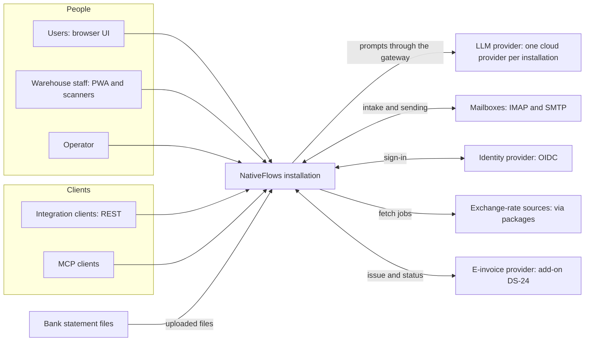
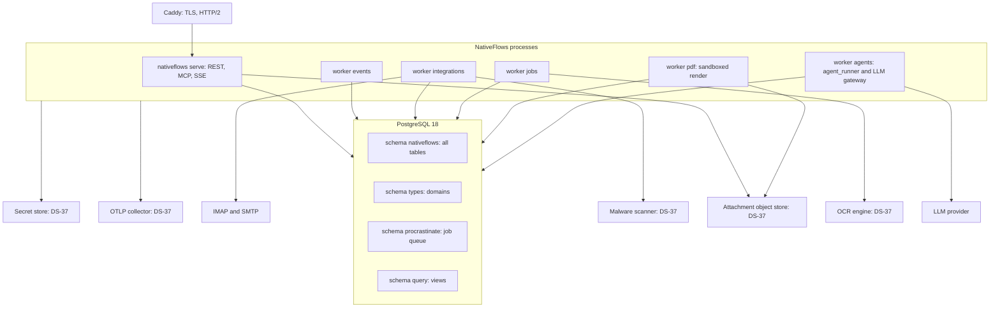
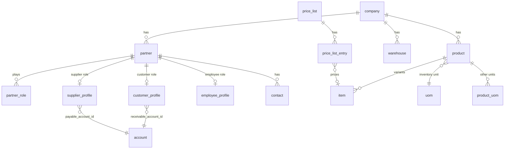
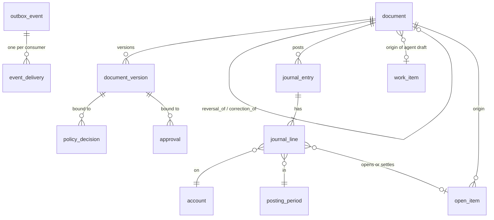
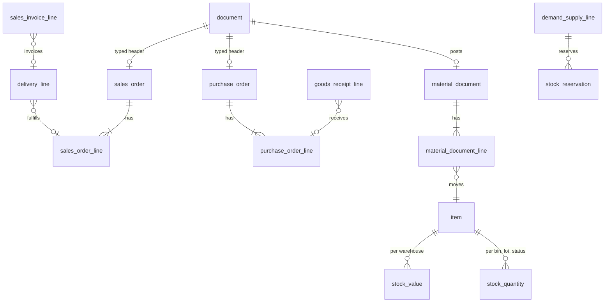
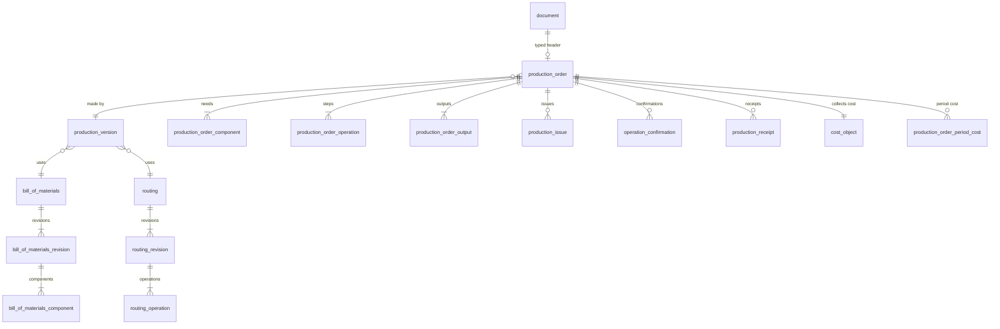
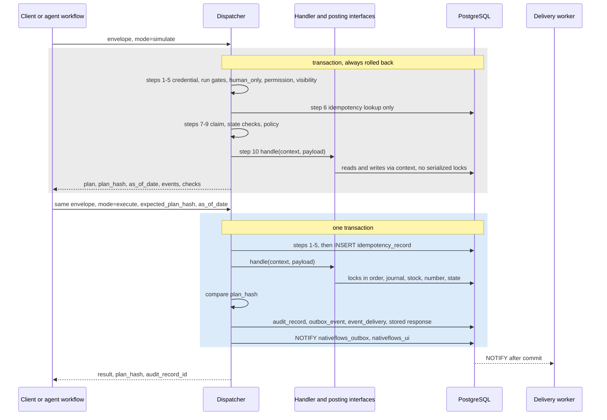
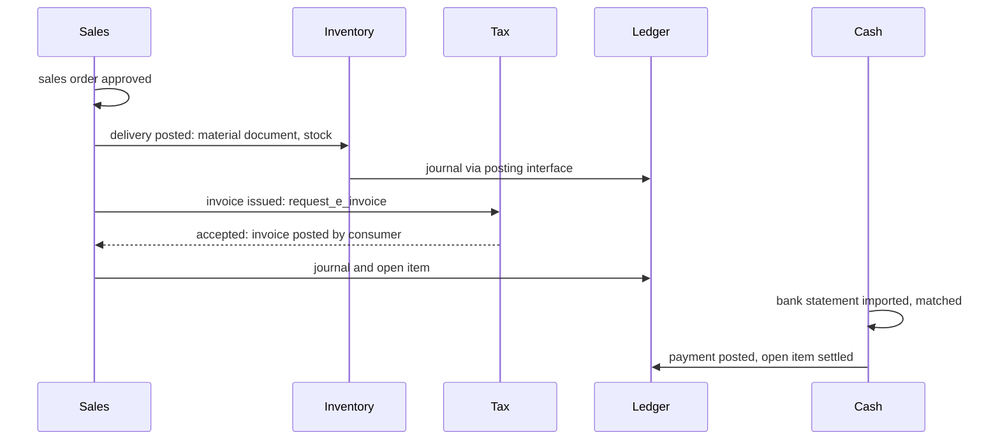
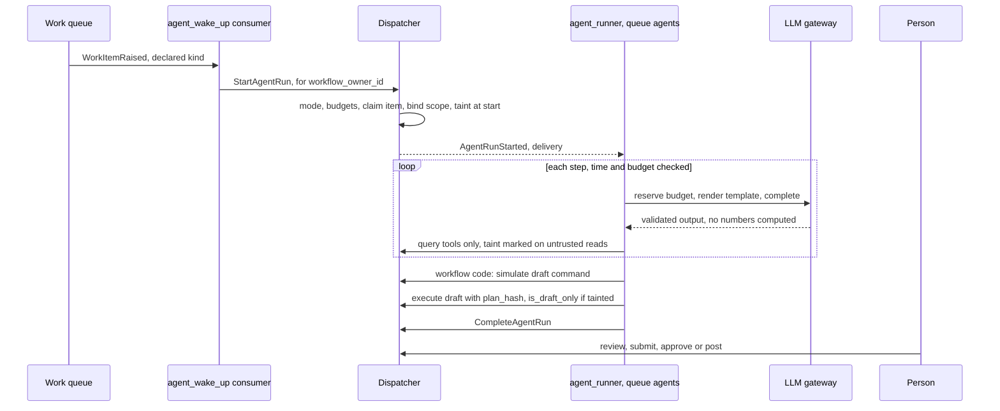
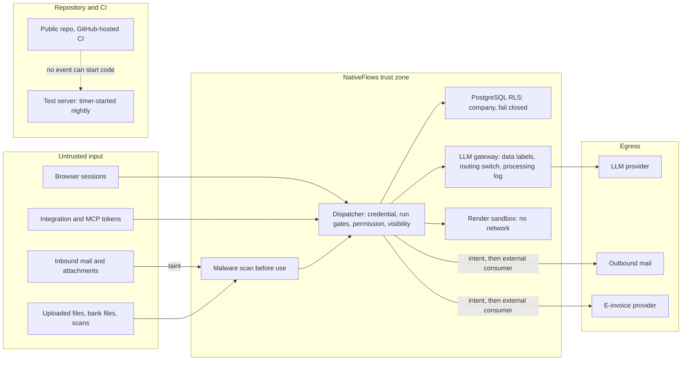

# NativeFlows architecture overview

For the author and design reviewers. Coding agents read the short [coder core](architecture-core.md) instead (Part A). Generated appendices are in [generated/](generated/) (Part C).

**Rule of this document.** It summarizes and links. It creates no rule. Where an ADR, a DDL draft or a catalog disagrees with another, the point is listed under [Findings for the review](#findings-for-the-review) with `file:line`, and is not resolved here. ADRs win over this file.

Status: written 2026-11-16 against `main`, from the outline approved after a systems review and a developer review. Revised 2026-11-16 after independent review round 1, and updated the same day for the design hardening notes (budgets set by the customer, the pinned business date, unknown external outcomes, one restore point for database and attachments, bulk review). Facts that could not be confirmed would be marked "(to verify)"; none remain.

## Contents

B1 [Purpose and scope](#b1-purpose-and-scope) · B2 [System context](#b2-system-context) · B3 [Runtime view](#b3-runtime-view) · B4 [Tenancy and isolation](#b4-tenancy-and-isolation) · B5 [Module map](#b5-module-map) · B6 [Data architecture](#b6-data-architecture) · B7 [Transactions, concurrency and failure](#b7-transactions-concurrency-and-failure) · B8 [Business flows](#b8-business-flows-at-a-glance) · B9 [Agents](#b9-agent-architecture) · B10 [Configurability](#b10-configurability) · B11 [Localization](#b11-localization-and-regimes) · B12 [Security](#b12-security-architecture) · B13 [Data lifecycle and operations](#b13-data-lifecycle-and-operations) · B14 [Non-functional targets](#b14-non-functional-targets) · B15 [Frontend](#b15-frontend-overview) · B16 [Build and delivery](#b16-build-and-delivery) · B17 [Product shape](#b17-product-shape-and-separability) · B18 [Open decisions](#b18-open-decisions-and-known-limits) · [Findings](#findings-for-the-review)

## B1. Purpose and scope

NativeFlows is an open-source ERP designed for agentic workflows, for trading and assembly businesses (01-vision:3), with production in Phase 1 for manufacturers ([ADR-0032](../adr/0032-phase-1-scope-with-production.md) rule 1), and with CRM from the start. Its accounting and inventory core follows SAP concepts (S/4HANA for the data model, Business One for a lean first release; no company-size limit, the design scales to large enterprises) ([01-vision](../spec/01-vision.md):3; D5). Country rules live in localization packages ([ADR-0016](../adr/0016-localization-package-structure.md)).

**Phase 1** is defined by [spec 09](../spec/09-mvp-scope.md) as amended by [ADR-0032](../adr/0032-phase-1-scope-with-production.md): every capability a customer cannot operate without is in Phase 1 in full depth, and production, multi-level MRP, planning and subcontracting move into Phase 1 (ADR-0032:7–16). Spec 09 itself still shows production as later; that wording waits for the author ([open-questions](../open-questions.md):122).

**Five ideas the design follows** (Principles in [02-principles](../spec/02-principles.md):7–19; D2, D4):
1. **Deterministic core, AI proposes.** "The business core is fully deterministic; AI lives only in the proposal layer" (01-vision:13). Agents draft; people submit, approve and post.
2. **Every write is a schema'd command, simulated before executed** (Principles 1, 2, 9). One envelope, two calls, one `plan_hash` ([ADR-0008](../adr/0008-command-envelope-and-registry.md)). Only internal callers (consumers and system jobs, in process) execute without a simulation; everyone else simulates first (ADR-0008 rule 13 and its note).
3. **Append-only books and explainable numbers** (Principles 5, 6). Posted documents are immutable and corrected by correction documents ([ADR-0009](../adr/0009-document-lifecycle.md)).
4. **State tables plus a transactional outbox; no event sourcing** (D4; [ADR-0013](../adr/0013-outbox-and-events.md)). The work queue is central (Principle 8).
5. **Fully usable without an LLM** (Principle 12). Every agent run is bound to a work item, and every consumer works with the LLM off.

## B2. System context



- **LLM provider.** One provider per installation in Phase 1; `llm_provider` accepts only `anthropic`; the `local` adapter is designed but not enabled. If unset, the LLM is off and everything works by hand ([ADR-0050](../adr/0050-agent-runtime-and-query-layer.md):52–63).
- **Mailboxes.** `crm.contract.MailboxConnector`, IMAP over TLS and SMTP submission ([ADR-0052](../adr/0052-minimal-crm.md):112).
- **Bank files.** `ImportBankStatement` runs the package's `BankStatementReader`; no money moves from NativeFlows in Phase 1 ([ADR-0048](../adr/0048-cash-bank-receivables-payables.md):97, :114).
- **E-invoices.** The provider connection is an add-on designed after the core; a deterministic stub stands in ([backlog](backlog.md):77; [ADR-0028](../adr/0028-document-lifecycle-hardening.md):107).
- **Identity.** Password (argon2) with TOTP, or OIDC through Authlib; no separate identity server ([ADR-0017](../adr/0017-permission-envelope.md):14; [ADR-0002](../adr/0002-core-technology-tools.md):29).
- **Warehouse app.** The same React app as a PWA, with wedge, camera and manual scans ([ADR-0061](../adr/0061-barcodes.md):123; D14).

**Stack** ([ADR-0001](../adr/0001-programming-language.md), [ADR-0002](../adr/0002-core-technology-tools.md), [ADR-0022](../adr/0022-repository-and-engineering-conventions.md) rule 11). Versions are stated only where shown.

| Area | Choice |
| --- | --- |
| Language and database | Python 3.14, PostgreSQL 18 (ADR-0006:14; ADR-0022:183); TypeScript for the UI |
| Backend | FastAPI; official MCP Python SDK; pydantic v2; SQLAlchemy 2 Core (no ORM); psycopg 3; Alembic; Procrastinate on PostgreSQL (ADR-0002:17–23) |
| Documents and files | Jinja2 → HTML → WeasyPrint; lxml, xmlschema; XlsxWriter, openpyxl; Zint in the PDF worker (ADR-0002:26–33) |
| Search and matching | pg_trgm, rapidfuzz (ADR-0002:25) |
| Security | argon2, pyotp, Authlib (ADR-0002:29) |
| Observability | structlog, OpenTelemetry (ADR-0002:31) |
| Testing | pytest on real PostgreSQL via testcontainers, Hypothesis (ADR-0002:35) |
| Frontend | React, TypeScript, Vite, openapi-typescript, TanStack Query and Router, shadcn/ui, react-hook-form, i18next (ADR-0002:41–47); AG Grid replaced by the in-repository TanStack Table grid `line_grid` ([ADR-0077](../adr/0077-ui-floorplans-annotations-and-embedded-agent.md) rule 5) |
| Infrastructure | Docker Compose, Caddy, pgBackRest, GitHub Actions (ADR-0002:52) |
| Not used | Heavy ORMs, event sourcing, microservices, GraphQL, Kafka, Redis, Elasticsearch, LangChain, a workflow engine (ADR-0002:68) |

## B3. Runtime view

**Processes** (ADR-0022 rules 5, 9, 12; ADR-0013 rules 6, 13).

| Process | Role | Database role | Notes |
| --- | --- | --- | --- |
| `nativeflows serve` | REST and MCP API, SSE stream for live screens | `nativeflows_app` | Rate limits per actor 20/5/50 rps for human/agent/integration (ADR-0022 rule 9); SSE per [ADR-0040](../adr/0040-ui-architecture.md) rule 13 |
| `nativeflows worker --queue events` | Transactional consumers | `nativeflows_worker` | Claims through the definer function owned by `nativeflows_claim` (ADR-0017 rule 19) |
| `nativeflows worker --queue integrations` | External consumers: e-invoice, mail, malware scan | `nativeflows_worker` | Calls with no transaction open (ADR-0013 rule 10) |
| `nativeflows worker --queue jobs` | System jobs, scheduled jobs, long-job consumers | `nativeflows_worker` | Procrastinate periodic tasks; stalled-job retry (ADR-0022 rule 12) |
| `nativeflows worker --queue pdf` | Render worker | `nativeflows_worker` | Own process, sandboxed, 30-min lease, 3 attempts ([ADR-0049](../adr/0049-statutory-reporting-and-printing.md):199) |
| `nativeflows worker --queue agents` | `agent_runner` | `nativeflows_worker`, derived from ADR-0017 rule 18 ("`nativeflows_worker` runs delivery workers and system jobs") plus ADR-0050:164 (`agent_runner` is a consumer); a run's read-only queries use `nativeflows_readonly` (ADR-0050:387) | 5-min lease with a 60-s heartbeat (ADR-0013:62; ADR-0050:164) |
| `nativeflows admin migrate` / `bootstrap` | Migrations, catalogs, package data; first operator and owner | `nativeflows_migration` | Only role with `BYPASSRLS` (ADR-0017 rule 18) |
| Read-only query layer | Views in schema `query` | `nativeflows_readonly` | Statement timeout 10 s for agent runs, 30 s otherwise (ADR-0050:387) |

ADR-0022 rule 12 lists four worker queues; ADR-0013 rule 13 adds `agents`. Five queues are shown here; the difference is a [finding](#findings-for-the-review).

**Containers**



- Schemas `nativeflows`, `types`, `procrastinate`, `query` ([ADR-0022](../adr/0022-repository-and-engineering-conventions.md) rule 7).
- Attachment bytes live in an object store, never in the database ([ADR-0027](../adr/0027-cross-cutting-ownership.md):38). The upload endpoint streams to it, then dispatches `CreateAttachment` ([ADR-0038](../adr/0038-audit-and-observability.md):134).
- The scanner runs as a consumer of `AttachmentCreated` on `integrations` (ADR-0038:142). Scanner, collector and telemetry backend are chosen in DS-37 (ADR-0038:125).
- The secret store holds the LLM key, mailbox credentials and `automation.value_hmac_key` (ADR-0050:61; ADR-0052:110; [ADR-0058](../adr/0058-configurable-workflows.md):212). Its product is DS-37.
- The OCR engine is a self-hosted installation component ([ADR-0057](../adr/0057-document-intake-and-extraction.md):80). Intake extraction runs in the consumer `document_extraction_runner`, a long job on queue `jobs` (ADR-0057:57).
- In `test` and `simulation`, every external lookup and gateway is a recording stub (ADR-0022 rule 9).
- Deployment beyond the test server (Compose services, hosts, single-host assumption) waits for DS-37 ([backlog](backlog.md):49).

## B4. Tenancy and isolation

- **One installation, many companies.** One user account works in several companies ([ADR-0054](../adr/0054-users-roles-and-authorizations.md):21, :47). Group currency is an installation setting ([ADR-0011](../adr/0011-multi-currency.md):22).
- **Company context first, RLS second.** The dispatcher checks company, record scope and owner scope (step 5). PostgreSQL RLS pins each transaction to `nativeflows.company_id` and fails closed; null-company rows need the value `installation`; registered cross-company queries use `nativeflows.company_ids` under a second, read-only policy ([ADR-0017](../adr/0017-permission-envelope.md) rule 19). RLS guards companies only; record scope and field classes stay in the dispatcher and views.
- **Installation tables** have no `company_id`: e.g. `event_subject`, `event_consumer`, `agent_type`, `agent_type_version` (DS-05-platform.sql:19).
- **Settings.** Scopes are installation, regime, company and narrower. An installation value is a maximum that narrower scopes may only tighten ([ADR-0063](../adr/0063-configurable-policy-settings.md):23–25).
- **Assumption, not decided:** whether unrelated customers always get separate installations is not stated in any ADR. The systems review proposed recording it as an assumption by ADR.

## B5. Module map

The [module cards](generated/module-cards.md) are generated. Layers and modules: [ADR-0022](../adr/0022-repository-and-engineering-conventions.md) rule 2, listed in [Part A](architecture-core.md#layer-table-adr-0022-rule-2).

- **Layer 1, Foundation** (`numeric`, `clock`, `ids`, `i18n`, `errors`): exact decimals, the two kinds of time, IDs and errors. No tables.
- **Layer 2, Platform**: the command path (`registry`, `db`, `permissions`, `policy`), the document row and its versions and numbers (`documents`, `periods`), the outbox (`outbox`), audit (`audit`), files (`attachments`), the work queue (`work`), agent run records (`agent_runs`) and decision artifacts (`configuration`). `registry` also owns the settings tables (DS-28-settings.sql:16).
- **Layer 3, Core business**: `ledger` (journal, accounts, account determination, multi-currency), `inventory` (material documents, stock, costing, warehouse management), `master_data`, `tax`, `production`; `assets` in Phase 3.
- **Layer 4, Commercial**: `sales`, `purchasing`, `cash`, `reporting`, `crm`, `planning`, `quality` ([ADR-0070](../adr/0070-quality-management-core.md), 2026-11-21).
- **Layer 5, Interfaces**: `api` (REST and MCP from the registry), `query` (read-only views and the analysis layer), `agents` (gateway, runtime, workflows), `sdk`, `imports`, `automation`.
- **Layer 6**: `app`, the composition root.

Generated counts from the DDL drafts (2026-11-21): 399 tables, each with a stated owner, in 25 modules; the largest are `master_data` (74), `production` (53), `inventory` (44) and `crm` (24) ([data map](generated/data-map.md)).

## B6. Data architecture

### Spines

Four small ERDs, drawn from the DDL drafts. Columns are omitted, and so is how each key is composed; the DDL shows that (composite company keys are required in `master_data` and `crm` by ADR-0045 rule 1 and ADR-0052 rule 3).

**Master data** (DS-20-master-data.sql)



**Documents and journal** (DS-05-platform.sql, DS-06-universal-journal.sql)



**Inventory and commercial** (DS-22-09-42-commercial-inventory.sql, DS-43-54-planning-production.sql)



**Production** (DS-43-54-planning-production.sql, DS-06-universal-journal.sql)



**Other spines, one paragraph each**
- **Platform records.** `outbox_event`, `event_delivery`, `event_subject`, `audit_record`, `audit_change`, `audit_denial`, `work_item` with links and notes, `work_case` with its links ([ADR-0013](../adr/0013-outbox-and-events.md); [ADR-0038](../adr/0038-audit-and-observability.md); [ADR-0042](../adr/0042-work-queue.md); [ADR-0066](../adr/0066-work-cases.md), accepted 2026-11-21).
- **Access.** `user_account`, roles with levels per authorization area, assignments with record and owner scope, delegations, segregation rules, approval pools and stages (DS-15-access.sql; [ADR-0054](../adr/0054-users-roles-and-authorizations.md); [ADR-0055](../adr/0055-approval-pools-and-stages.md)).
- **Agents and artifacts.** `agent_type`, versions, settings, `agent_run`, `agent_run_step`, budgets and promotion evidence; automation rules, decision tables, parameter sets and their evidence (DS-05-platform.sql; DS-28-34-configuration-artifacts.sql).
- **Cash.** `money_account`, bank statements and lines, payments and lines, `open_item_collection` ([ADR-0048](../adr/0048-cash-bank-receivables-payables.md)).
- **CRM.** Interactions, inbound and outbound messages with separate personal content tables, complaints, processing purposes and bases, data subject requests ([ADR-0052](../adr/0052-minimal-crm.md); DS-35-crm.sql).
- **Intake and analysis.** Extractions with words, fields, rule runs and confirmations ([ADR-0057](../adr/0057-document-intake-and-extraction.md)); analysis questions, saved analyses and examples ([ADR-0060](../adr/0060-agent-assisted-reporting-and-analysis.md)).

### Cross-module references

- **Foreign keys are not imports.** All tables share schema `nativeflows` and keys cross modules by design (ADR-0022 rule 7), often pointing up the layers (e.g. `document.partner_id`, layer 2 → layer 3). The [data map](generated/data-map.md#cross-module-foreign-keys-report) reports 422 cross-module foreign keys with their direction. It gives no allowlist verdicts; an allowlist with a reason per edge is a later step.
- **Polymorphic references** (`subject_table`/`subject_id`, `target_table`/`target_id`, `case_table`/`case_id`) are listed separately: 19 pairs, in `outbox_event`, `event_delivery`, `event_subject`, `audit_record`, `audit_denial`, `work_item`, `work_item_link`, `attachment_link`, `change_proposal_item` and others. Invariants check them, e.g. INV-83 for `attachment_link` (ADR-0027 rule 2).
- **Event coupling.** The [event matrix](generated/event-matrix.md) lists 80 event types named in the ADRs, their producing module and the consumers named with them. Generic document events (`<Type>Posted` for every type, ADR-0009 rule 22) are not enumerated there.

### Ownership and stub tables

Each table has exactly one owning module (ADR-0022 rule 7). Ownership exists today only in SQL comments, which the generator parses. Since S2 schema phase A (2026-11-21) every table has one owner and every lab stub has design DDL (findings 5 to 7):
- every CREATE TABLE line of DS-06-universal-journal.sql, and the 10 tables of sections that name two owners, carry a `[module]` bracket;
- `account`, `system_account`, `transaction_key` and `applied_rate` are in DS-06-universal-journal.sql; `fiscal_year`, `posting_period`, `posting_period_area_state`, `close_task` and `tax_code` are in DS-05-platform.sql. Their five lab stubs stay only for the labs that load DS-06 without DS-05, with the design columns (D6; lab check t15 A02b).

The generator fails on any new unowned or stub table; its list of acknowledged findings is empty.

**Generation.** Part C is written now by the lab script `docs/reviews/2026-11-14-design-validation/lab/gen_overview.py` (with `--check`), because `nativeflows-dev generate` does not exist yet. `nativeflows-dev generate` takes this over at build step 0 (ADR-0022 rules 14, 17), reading the registry and `tables.py` instead of the DDL drafts.

## B7. Transactions, concurrency and failure

**Boundaries**
- One command, or one batch, runs in one transaction. Simulate rolls it back; execute commits it (ADR-0008 rules 9, 20).
- **Who executes without simulate.** Only internal callers: consumers and system jobs calling the dispatcher in process, the change-proposal executor among them with its stored plan hash (ADR-0008 rule 13 and its note; ADR-0013 rule 9). People, agents, integrations and MCP clients simulate first and execute with `expected_plan_hash` (Principle 2).
- **Pinned business date.** A simulation returns the `as_of_date` it used for `clock.today(company)`. An execution that sends it reads that date in every `clock.today` call, and the date is part of the hashed plan, so `plan_hash` stays equal across midnight. An `as_of_date` more than one day from the business date is refused (`as_of_date_out_of_range`). `posting_date` stays explicit, and internal callers keep the date fixed when the job was enqueued ([ADR-0007](../adr/0007-time-model.md) rules 15, 17 and the rule 15 note; ADR-0008 rules 7, 12, 13 notes; [DS-04](DS-04-command-envelope.md)).
- The idempotency record is taken first and held to commit. Locks then follow the one global order of [ADR-0027](../adr/0027-cross-cutting-ownership.md) rule 10 (documents → period state → planning or structure or configuration state → warehouse tasks → handling units → `stock_value` → `stock_quantity` → bins → partners → `money_account_balance` → open items → numbering counters → `event_subject`).
- Timeouts: `lock_timeout` 5 s; `transaction_timeout` 30 s, 4 min for consumers, 15 min for registered long jobs; idle in transaction 60 s (ADR-0022 rule 9). Exceeding one returns `concurrent_update` or `timeout`, both retryable.
- Simulation takes no serialized-row lock and consumes no number (ADR-0008 rule 10). Handler paths use no sequences, session advisory locks or non-`LOCAL` `SET` (ADR-0008 rule 9); transaction-level advisory locks are allowed (ADR-0022 rule 13 note).
- Deliveries are claimed with `SKIP LOCKED`, ordered per consumer and subject; leases are technical timers (ADR-0013 rule 7).

**Life of a command**



**Failure, detection, automatic behavior, human action**

| Failure | Detection | Automatic behavior | Human action |
| --- | --- | --- | --- |
| Lock or transaction timeout, deadlock | `concurrent_update`, `timeout`; metrics (ADR-0038:103) | Rolled back, idempotency row included; a retry with the same key runs again (ADR-0008 rules 11, 16) | None |
| Database down, failover | Not specified | Not specified | Not specified (DS-37) |
| Worker crash | `locked_until` passes | Delivery returns to `pending`, attempt counts (ADR-0013 rule 7) | None |
| Delivery keeps failing | `held` after `max_attempts`; operations dashboard; work item where it matters (ADR-0013 rule 8) | Blocks later events of the subject for that consumer | `RetryEventDelivery` or `SkipEventDelivery` |
| External call, outcome unknown | Crash or timeout after the call | Our reference is the provider's idempotency key where it has one; the retry waits the settle delay `integrations.<provider>.status_settle_delay_minutes` (default 10) and resends only when two status queries at least that far apart both find nothing; the document stays in `issuing` or `sending`; mail searches the Sent folder the same way and never resends blindly (ADR-0013 rule 10 note; ADR-0052:286) | After `integrations.<provider>.max_unknown_rounds` (default 3): the delivery is held with `external_call_outcome_unknown`, or `outbound_message_failed` for mail (ADR-0052:285) |
| LLM provider down | Provider errors | 2 retries, then `provider_unavailable`; breaker opens after 5 failures in 60 s, for 5 min (ADR-0050:69–71) | Work item `agent_run_stopped`; the item returns to people |
| Agent budget exceeded | Reservation of the worst case before each call on the run, agent type, company, outside-content pool and installation rows (ADR-0050 rule 23 note); in Phase 1 the agent type row counts and carries the company cap as its limit (ADR-0078 rule 7) | Run stops `budget_exceeded`; daily breaker (ADR-0050:248, :256) | Work item `agent_budget_exhausted`; raising a cap is a change proposal another person approves |
| Agent run crash | Lease expiry | Retried at most 3 times, then outcome `crashed` (ADR-0050:168–174) | Work item |
| Mailbox unreachable | Failure count | Cursor makes refetch safe (ADR-0052:129) | `mailbox_unreachable` after 3 failures (ADR-0052:130) |
| PDF render fails | Job state | 30-min lease, 3 attempts; `render_failed`, `render_too_large` (ADR-0049:199–200) | Held delivery on the dashboard (ADR-0049:322) |
| Malware scanner down | Consumer failures | Retries, then held; unscanned bytes are never served and `Post` is refused (ADR-0038:142–146) | Release the held delivery |
| Object store unavailable | Not specified | Not specified | Not specified (DS-37) |
| LLM switched off | `llm_provider` unset | Every agent mode is off (ADR-0050:63) | Work continues by hand (Principle 12) |

**Delivery mechanics** (moved from Part A). After commit, `NOTIFY nativeflows_outbox` wakes the workers, which also poll every 5 s (ADR-0022 rule 12). A worker claims a `pending` delivery with `FOR UPDATE SKIP LOCKED` only when no earlier delivery of that consumer and subject is open, with a 5-minute lease (ADR-0013 rule 7). After `max_attempts` (default 10) the delivery is `held` and blocks its subject for that consumer until a human runs `RetryEventDelivery` or `SkipEventDelivery` (ADR-0013 rule 8). Outside calls are recorded as intents by a command and made by an `external` consumer on `integrations` with no transaction open (ADR-0013 rule 10).

**Error codes.** New codes go into the registry's catalog with the same columns; envelope-level codes are defined only in DS-04 ([DS-04](DS-04-command-envelope.md), Error catalog).

**Event delivery with an unknown external outcome** (ADR-0013 rule 10 and its note; e-invoice example, [ADR-0028](../adr/0028-document-lifecycle-hardening.md) rule 7)

```mermaid
sequenceDiagram
  participant H as Command, e.g. IssueSalesInvoice
  participant DB as PostgreSQL
  participant X as External consumer on integrations
  participant P as Provider
  H->>DB: tx: intent with our reference, event, delivery
  X->>DB: tx 1: claim delivery SKIP LOCKED, running, lease
  X->>P: call with our reference as idempotency key, no transaction open
  P--xX: timeout or crash, outcome unknown
  note over X,DB: document stays in issuing; next attempt after the settle delay
  X->>DB: tx 1: claim again, attempts + 1
  X->>P: status query 1 of our reference
  note over X,P: wait at least the settle delay
  X->>P: status query 2 of our reference
  alt provider has it
    P-->>X: accepted or rejected
  else both queries find nothing
    X->>P: send again with the same idempotency key
    P-->>X: outcome
  end
  X->>DB: tx 2: record outcome by command, delivery done
  note over DB: after max_unknown_rounds: held, external_call_outcome_unknown, a person checks with the provider
```

## B8. Business flows at a glance

The 2026-11-15 simulation ran eleven flows twice on fresh databases with recorded LLM steps: 83 of 83 checks, 27 of 27 invariants, no trace differences ([simulation README](../reviews/2026-11-15-simulation/README.md):5; flows in [sim/README.md](../reviews/2026-11-15-simulation/sim/README.md):114–119 and :61–65). It is design evidence, not product code.

| Flow | Path | Simulation |
| --- | --- | --- |
| Customer onboarding | Intake → tainted onboarding agent → code checks → draft change proposal → a person submits, another approves → executor creates partner and contacts | `sim/flows/f1_customer.py` |
| Price list | Create list, quantity breaks, end-dating, overlap refused, option extras, assignment | `f2_price_list.py` |
| Configure, price, quote | Tainted e-mail run → person's note → untainted run → priced draft quotation → agent's Submit refused → clerk submits → pool approval → reply sent | `f3_cpq.py` |
| Order to cash | Sales order → credit check → approval → production issue and receipt → delivery → invoice `Issue` (`issuing`) → stub adapter → post → bank statement → matching cascade → people post receipts | `f4_o2c.py` |
| Planning | Forecast → MRP run → planned orders and exceptions → planning agent proposal → approval → purchase request and production order → release | `f5_planning.py` |
| Procure to pay | Purchase request → order → goods receipt (GR/IR) → e-invoice record → tainted purchase invoice agent → match exceeded → approval → post → payment | `f6_p2p.py`, `f6_uom.py` |
| Intake | Mailbox → XML rung → e-invoice record → match → duplicate suspected, payment blocked, review releases | `f7_intake.py` |
| Barcode | GS1-128 scan → `EvaluateBarcode` → receipt line in packaging unit, lot and expiry | `f8_barcode.py` |
| Workflows and settings | Decision table → rule → activation proposal → dispatch; setting tighten and loosen | `f9_workflow_settings.py` |
| Analysis | Question → plan → validate → code computes → narrative rendered | `f10_analysis.py` |
| Production agent | Release with shortage → reservation transfer proposal → receipt sweep → shop-floor sheet extraction → drafted confirmation → posted by a person → variance by code | `f11_production.py` |

Sequence of the two main chains, at document level:



Procure to pay mirrors it: purchase order → goods receipt (stock and GR/IR) → purchase invoice (match, GR/IR clearing, open item) → payment ([ADR-0047](../adr/0047-commercial-documents-and-pricing.md); [ADR-0048](../adr/0048-cash-bank-receivables-payables.md)).

## B9. Agent architecture

**Runtime** ([ADR-0050](../adr/0050-agent-runtime-and-query-layer.md))
- `agent_runs` (layer 2) holds the run tables and contracts; `agents` (layer 5) holds the gateway, runtime and workflows; `query` (layer 5) holds the views (ADR-0050:33–35). No agent framework (ADR-0050:39).
- Every LLM call goes through `agents.gateway.complete`. Prompts are rendered from versioned templates and typed context items, never assembled by workflow code (ADR-0050:47, :79–82).
- LLM steps get queries only. Workflow code builds each command from validated output, simulates it, checks it and executes it with the `plan_hash` (ADR-0050:328–331).
- Tool lists are fixed per agent type version and checked on every call. Never on a tool list: posting commands, `Submit`, `Post`, `Issue`, `Approve`, `Reject`, `human_only` and `outbound_send` commands, among others (ADR-0050 rule 30; INV-214).
- Rights are the intersection of the agent type's and the acting human's, re-evaluated per call (ADR-0050:323; ADR-0017 rule 11).
- **Taint.** `agent_run.tainted_at` is set once, committed before untrusted data is returned. A tainted run may run only `is_draft_only` commands and reads only its tainted scope ([ADR-0029](../adr/0029-proposals-and-agent-safety.md) rule 14; ADR-0050:265–285). A document version's taint can be cleared by a person only: `ClearTaint` (`human_only`, with a reason, never by the human the tainted run acted for) writes an immutable `taint_clearance` row (ADR-0029 rule 8). Only who may clear is open for the author ([open-questions](../open-questions.md):36).
- **Fewer clicks on deterministic paths.** Values that pass [ADR-0057](../adr/0057-document-intake-and-extraction.md) rule 17's checks are trusted and do not taint a run. Evidence-gated auto-post paths post deterministic or evidenced matches without a person, through the auto-post gateway below, confirmed in batches before close ([ADR-0051](../adr/0051-agent-workflows.md) rule 18; [ADR-0063](../adr/0063-configurable-policy-settings.md) rules 9–10). Bulk review lets a person submit or approve up to `work.bulk_review_max_items` (default 50) drafts that hold only trusted values and have no check results in one action; each still runs as its own command with its own approval record ([ADR-0042](../adr/0042-work-queue.md) rule 12 note; [ADR-0055](../adr/0055-approval-pools-and-stages.md) rule 7 note).
- **Auto-post gateway (maker-checker, proposed).** Every unattended posting goes through one gateway in `policy` ([ADR-0065](../adr/0065-deterministic-auto-post-gateway.md)). An agent or import makes a draft; `RunAutoPostGateway` (`automation`, its own causation chain, no origin run) simulates `Post<Type>` as `system`; the gateway checks the draft and its plan with the document type's registered checker and returns `auto_post`, `require_human` or `reject`, written as a `policy_decision` row with the checker's evidence. An `auto_post` executes with the simulated `plan_hash` and `as_of_date` and is confirmed by the policy rule's owner. No LLM in the checker, fail closed, read-only, plan check (rules 3–7). Thresholds are customer settings, mode `off` by default; a type goes `shadow`, then `live` only on evidence at `auto_post.max_error_rate` and a second person's approval; one wrong auto-post suspends the type (rules 8, 14–16). Tainted drafts may pass only when the company and the type enable it, the agent type is `active` and every amount and quantity is verified, by the author's decision of 2026-11-16 (rules 10–12). Instances: the purchase invoice (first), the bank cascade and the production import (unchanged behavior) (rules 19–20).
- **Work cases (proposed).** A `work_case` in `work` groups one business intent by link only: origin, work items, agent runs, drafts and resulting documents; its timeline is a query, nothing is copied, and no core rule changes ([ADR-0066](../adr/0066-work-cases.md)). Cases serve unstructured and exception work (Phase 1 kinds `quote_request`, `customer_issue`, `supplier_invoice`, `customer_onboarding`, each `off` until the company turns it on); routine structured work keeps the traditional screens. In mode `auto` the consumer `work_case_opener` (`automation`) opens a case on the raise of the kind's trigger work item. A case never widens an agent's read scope, holds no taint (the summary is computed, clearance stays per version) and adds no approval: actions taken from it are separate commands under the bulk-review rules (rules 6, 16, 18–20).
- **Budgets and stops.** Worst-case cost is reserved before each call; the third denial stops a run; invalid output gets two retries (ADR-0050:229–252, :333, :344). The customer sets every cap in the settings registry: the operator sets the installation maxima at deployment (`agents.installation_daily_max_cost`, default USD 200, and the maximum of company caps); each company sets its cap (`agents.company_daily_max_cost`, default USD 50); the per-run ceilings are those the agent type version declares, and in Phase 1 the customer lowers only the assistant's cost per run (`assist.max_cost_per_run`). There are no per-agent-type daily caps in Phase 1 (ADR-0078 rule 7). Lowering is immediate; raising is a proposal another person approves. `agents.internal_reserve_share` (default 0.40) keeps that share of the company cap for agent types that read no outside content (ADR-0050 rules 22–23 notes).
- **Change proposals.** Master-data changes and `is_proposal_bound` commands from agents go through a change proposal that a person submits and another person approves ([ADR-0029](../adr/0029-proposals-and-agent-safety.md) rules 1–4).

**An agent run**



**Agent types** (twelve)

| Agent type | ADR | Drafts | Who acts on it |
| --- | --- | --- | --- |
| `customer_onboarding` | [0051](../adr/0051-agent-workflows.md):8 | Change proposal for partner and contacts | A person submits; another approves |
| `quotation` | 0051:9 | Quotation draft without price, discount or tax; reply draft | Salesperson submits; a person sends |
| `bank_matching` | 0051:10 | Suggestion on the bank line | A person posts or matches |
| `purchase_invoice` | 0051:11 | Draft purchase invoice; item mapping proposal | Accountant submits and posts |
| `planning` | 0051:12 | Change proposal for planned-order actions | Planner submits; an eligible approver approves |
| `data_migration` | 0051:13 | Draft import batch, mapping, duplicate suggestions | A person runs `RunImport` (`human_only`) |
| `document_reader` | [0057](../adr/0057-document-intake-and-extraction.md):120–128 | Vision values as extraction fields | A person verifies |
| `analysis` | [0060](../adr/0060-agent-assisted-reporting-and-analysis.md):249–257 | An answer on the asker's question | The asker reads; saved analyses need a proposal |
| `product_engineering` | [0062](../adr/0062-product-engineering-workflow.md):25 | Item proposals, BOM and routing drafts, estimate with gaps | A person submits; another approves release |
| `production` | [0064](../adr/0064-production-agent.md):35 | Reservations (deterministic), drafts, change orders, proposals | People release, post, approve |
| `production_capture` | 0064:36 | Tainted draft confirmations, issues, receipts | A person posts every draft |
| `production_variance` | 0064:37 | An explanation only | Information |

**Where the LLM is allowed.** The common rule: the LLM never computes a price, tax, quantity, account, match or score; it reads, chooses among candidates code gave it, and writes text (ADR-0051:15). Every number in free text must equal a number in the input (ADR-0050:351). Numbers come only from code (ADR-0063:60).

| Task | Deterministic part | LLM role | Output | Approver |
| --- | --- | --- | --- | --- |
| Onboarding | Precheck, field checks against source spans | Classify intent, extract fields | Change proposal | Another person (ADR-0051:121–129) |
| Quotation | Item resolution, configuration evaluation, pricing, tax | Pick among ≤5 candidates; set configuration values; reply text | Draft quotation | Salesperson submits (ADR-0051:148–169) |
| Bank matching | Matching cascade before and after | Read reference tokens | Suggestion | A person; auto-post only for cascade matches without LLM (ADR-0051:182–189) |
| Purchase invoice | Line mapping, order-line selection, tax copied from record | Choose among ≤10 candidates | Draft invoice | Accountant (ADR-0051:224–233); or the auto-post gateway when the company enables it ([ADR-0065](../adr/0065-deterministic-auto-post-gateway.md), accepted 2026-11-21) |
| Planning | Candidate actions computed by code | Explain, pick a handle | Proposal | Eligible approver (ADR-0051:248–266) |
| Intake | Reader ladder (XML, embedded XML, QR, spreadsheet, PDF text, OCR); alignment check; totals recomputed | Vision values last, no confidence | Extraction fields | A person verifies (ADR-0057:57–135) |
| Analysis | Validator V1–V14, compiler to one `SELECT`, executor | Draft a JSON plan; narrative plan of claim codes | Cells and code-rendered sentences | Asker (ADR-0060:147–296) |
| Product engineering | Resolution ladder, checks, cost estimate | Quantity structure only; ≤5 candidates | Proposals and drafts | Another person (ADR-0062:11–108) |

**Evaluation and promotion.** One golden set per workflow from the synthetic dataset, with at least 90% equal answers; a replay suite on every commit; live evaluation capped at USD 10 and never on fork pull requests (ADR-0050:362–372). Promotion from `shadow` to `assisted` needs `agent_promotion_evidence` and an approved change proposal, with at least 10 business days of shadow (ADR-0050:134; ADR-0051:39). Decision artifacts follow ADR-0059's lifecycle draft → backtested → shadow → assisted → active → retired; AI drafts L1 parameters and L2 rules as data, never L3 code ([ADR-0059](../adr/0059-ai-tuning-and-development-of-deterministic-functions.md):9–11, :117–125).

**Intake and analysis.** Intake is a system job, not an agent; the reader ladder stops at the first valid record, and vision values that do not align with OCR words fill nothing ([ADR-0057](../adr/0057-document-intake-and-extraction.md):11, :57–71, :130–134). Analysis compiles a validated plan into one read-only `SELECT` under `nativeflows_readonly`; every cell equals the sum of its drill rows ([ADR-0060](../adr/0060-agent-assisted-reporting-and-analysis.md):11–13, :173–186).

## B10. Configurability

- **Settings registry.** Each definition has scope, core default or fail-closed, bounds, direction, leaf, change effect and outdating; values are append-only `setting_value` rows ([ADR-0063](../adr/0063-configurable-policy-settings.md):23–29; [settings.csv](../catalogs/settings.csv)).
- **Asymmetric change path.** Tightening is immediate and needs one person. Loosening needs an approved proposal with a second approver, and outdates dependent evidence. `UpdateCompanySetting` is `human_only` (ADR-0063:35–41).
- **Hard locks** cannot be configured away, e.g. numbers only from code (ADR-0063:56–69).
- **Workflows and automation** ([ADR-0058](../adr/0058-configurable-workflows.md)): three tiers (parameters, typed decision tables, event-condition-action rules), no scripting or expression language (:9, :30–35). Rules never approve, submit, post, send or change master data or settings (:11, :40). They may run only `is_automation_allowed` draft commands (:53); chains stop at depth 3 (:113); a circuit breaker disables failing rules (:126–129).
- **Auto-post gateway settings.** `auto_post.<document_type>.mode` (`off`, `shadow`, `live`), its maximum in company currency (default 0), allowed currencies, tainted drafts (off) and verified values (on), the purchase invoice's supplier history, price and quantity tolerances and full receipt, and the confirmation cadence; decision tables at the decision point `auto_post.<document_type>`; an `auto_post_advisor` agent drafts thresholds and tables through ADR-0059's lifecycle and never enables anything ([ADR-0065](../adr/0065-deterministic-auto-post-gateway.md) rules 8, 9, 17–18; accepted 2026-11-21).
- **Work case settings.** `work_case.<kind>.mode` (`off`, `manual`, `by_rule`, `auto`; default `off`), `work_case.<kind>.due_days` and `work.landing_page.<role_template>` (role template to `work_queue` or `case_list`), all `neutral`; automation rules gain the action `open_work_case` ([ADR-0066](../adr/0066-work-cases.md) rules 4, 7; accepted 2026-11-21).
- **Operating presets and QuickFlows.** A preset is a named, versioned bundle of registry settings, seeded policy rules, company settings with their own commands, and setup defaults for new records ([setting-presets.csv](../catalogs/setting-presets.csv)). Applying one runs the ordinary commands, recorded with the preset code; no business code reads a preset, and later changes simply diverge (`ListSettingPresetDrift`). `standard` holds the core defaults; `quickflows` turns on one-click post (`ui.post_review` `on_exceptions` up to `ui.post_review_max_amount`, which the implementer sets at setup and which stays 0 until then, with review reasons computed by the server and `is_review_skipped` in the audit record), approval from a risk amount up, the small-company mode and backflush at receipt. In the small-company mode, owners may approve untainted agent drafts from event or schedule runs, and the person a tainted run acted for may clear its versions one by one; each case is a segregation exception reviewed at period close. Before go-live (no journal entry outside the migration fiscal year, `company.first_operating_posting_at`), an implementer the owner acknowledged sets loosenings without a second approver, listed for review in `setup_loosening_review` ([ADR-0067](../adr/0067-quickflows-operating-presets.md) rules 2–13; accepted 2026-11-21).
- **Implementation-time setup.** The setup flow shows the registry by area with defaults, bounds and direction; a company starts on the core defaults; a first value that loosens needs a proposal, except on ADR-0067's setup path before go-live; upgrades never change behavior silently (`RunSettingUpgradeCheck`) (ADR-0063:8, :49–50).

## B11. Localization and regimes

- **Core neutrality.** The test: would the rule read the same for a company in a country the core has never seen? ([ADR-0053](../adr/0053-core-neutrality.md):26).
- **Packages.** `l10n/<code>/` with a manifest, regimes, templates, reports, settings, i18n, and code that implements only published interfaces; `l10n_*` imports only `nativeflows.sdk` ([ADR-0016](../adr/0016-localization-package-structure.md):13, :73; [DS-14](DS-14-localization-package.md)). A company uses one package and one regime (ADR-0016:14).
- **Basis and flags.** Every template entry carries `legal_source`, `author_decision` or `status: unverified`; in `production` an unverified setting fails with `regime_setting_unverified` (ADR-0016:41, :58).
- **`l10n_xx`.** A fictional test package with one regime `test` and dummy values; the loader refuses it in production (ADR-0053:155–164).
- **Vietnam.** The `l10n_vn` package is deferred work outside the core ([ADR-0039](../adr/0039-vietnam-package-tt99.md); ADR-0053:7). This overview does not summarize it.

## B12. Security architecture

**Trust boundaries**



**Threat model, by boundary**
- **Injected instructions in outside content.** Content from mail, files and extractions taints runs; tainted runs draft only; a tainted draft posts without a person only through the deterministic auto-post gateway, when the company enables it per document type ([ADR-0065](../adr/0065-deterministic-auto-post-gateway.md) rule 10, accepted 2026-11-21); the human acted for is bound from the trigger, never from a sender (ADR-0017 rule 12; ADR-0013 rule 11; [ADR-0029](../adr/0029-proposals-and-agent-safety.md) rules 8–14).
- **Privilege misuse.** Permissions, record and owner scope (documents record `owner_employee_id` and `created_by_user_id`, ADR-0054 rule 14), field classes (`cost`, `margin`, and `sensitive_personal` of [ADR-0079](../adr/0079-personal-data-protection.md) rule 11; separate from the data labels that govern LLM routing, ADR-0017 rule 10), segregation of duties ([ADR-0054](../adr/0054-users-roles-and-authorizations.md) rules 17–20; ADR-0017 rule 16). Only humans approve (ADR-0017 rule 15).
- **Cross-company leaks.** RLS with `FORCE ROW LEVEL SECURITY`, fail closed (ADR-0017 rules 18–19).
- **Data egress to the LLM.** Data labels and the routing switch, default off; with it on, typed placeholders, a residual scan and shape masks; the processing log is committed before the send (ADR-0050:86–101). The data-processing policy fails closed; providers are permitted with four eyes (ADR-0057:208–220).
- **Malicious files.** Type detected from bytes, SVG not allowed, 25 MiB limit, scanning before use (ADR-0038:133–146). Rendering runs in a Jinja2 sandbox with no network (ADR-0049:254–255).
- **Supply chain and CI.** GitHub-hosted runners only, actions pinned by SHA, `contents: read`, the labeling workflow never checks out the head, Dependabot off until approved; the nightly run starts from a timer on the test server, with a token limited to issues (ADR-0022 rules 13, 15, 16, 18). LLM evaluation never runs on fork pull requests (ADR-0050:370–371).
- **Operator.** `nativeflows_migration` is the only `BYPASSRLS` role; definer functions (`nativeflows_claim`, `nativeflows_invitation`, `nativeflows_setting_reader`) give narrow cross-row access (ADR-0017 rules 18–19).

**Authentication and sessions.** Argon2 with TOTP or OIDC; TOTP required by role flag; sessions server-side, idle 2 h, absolute 12 h, lockout 15 min after 10 failures; API tokens hashed, at most one year; run tokens bound to one run (ADR-0017:14–19; ADR-0054:69–74). Cookie `__Host-nativeflows_session` with CSRF header and Origin check (ADR-0040:147–148).

**Secrets.** Fields marked `is_secret` never reach a view, an agent result or a prompt (ADR-0050:104). Secret values live in the deployment's secret store (DS-37).

**Audit.** `audit_record` per executed command in the command's transaction; `audit_change` for change-tracked tables; coalesced `audit_denial`; all append-only and never deleted ([ADR-0038](../adr/0038-audit-and-observability.md):25–74). `personal_data_processing_log` holds IDs and field names only (ADR-0052:258–262).

## B13. Data lifecycle and operations

**Retention and partitioning**

| Data | Retention | Partitioning |
| --- | --- | --- |
| `idempotency_record` | 90 days by default (ADR-0008 rule 19) | None |
| `outbox_event` | 400 days; partitions with open deliveries are kept (ADR-0013 rule 15) | Monthly by `id` range (ADR-0006 rule 22) |
| `event_delivery` | `done`/`skipped` deleted after retention; `held` never automatically | None |
| `audit_record`, `audit_change` | Never deleted (ADR-0038) | Monthly by `id` range |
| `agent_run_step` | 400 days; the `agent_run` row is kept (ADR-0050:213) | Monthly by `id` range |
| Accounting attachments | `attachment_retention_years`, flagged unverified, so never purged until verified (ADR-0038:155) | — |
| Released attachment bytes (rejected, unlinked, erased) | Not served from release; physically deleted by the orphan sweep only after `attachments.delete_grace_days` (default 35, at least the database recovery window) ([ADR-0038](../adr/0038-audit-and-observability.md) rule 15 note) | — |
| Ledger tables | Append-only | Not partitioned in Phase 1 (ADR-0006 rule 23) |
| Procrastinate jobs | 30 days after finishing (ADR-0013 rule 15) | — |

A daily job creates partitions 3 months ahead (ADR-0022 rule 12). ADR-0002's sentence on fiscal-year partitioning is superseded by ADR-0006 rules 22–23 (see findings).

**Backup and restore.** pgBackRest is the tool (ADR-0002:52); a restore is tested, not only written, before go-live ([runbook/go-live](../runbook/go-live.md):19, :81); restores run with triggers disabled ([ADR-0014](../adr/0014-universal-journal.md):51). The database and the attachment store share one restore point: objects are write-once under SHA-256 keys, in a store with versioning or object lock where available; no object is deleted while a database restore point could still name it, because physical deletion waits `attachments.delete_grace_days`, at least the point-in-time-recovery window. Restoring the database to a time T finds every object referenced at T, and objects written later are swept as orphans after the grace period (ADR-0038 rules 13–15 notes). RPO and RTO are not stated anywhere.

**Upgrades and migrations.** One linear Alembic history; `nativeflows admin migrate` runs migrations, catalogs and package data (ADR-0022 rule 8). Event payloads get upcasters (ADR-0013 rule 17). Command schemas serve the current and previous major until the next LTS (ADR-0008 rule 23). Packages load at deploy, no downgrades (ADR-0016:15). Upgrade tests from N-2 and LTS ([07-shared-foundation](../spec/07-shared-foundation.md):83).

**Environments.** `environment` is `production`, `test` or `simulation`, set from `NATIVEFLOWS_ENVIRONMENT`, never changing away from `production`; non-production uses recording stubs (ADR-0022 rule 9). The test server holds synthetic data only (ADR-0022 rule 18) and rebuilds its database from empty every night (ADR-0022 rule 8). Staging comes from step 10; real data only in a rehearsal, deleted within 7 days ([ADR-0003](../adr/0003-build-operating-rules.md):12, :22).

**Observability** ([ADR-0038](../adr/0038-audit-and-observability.md) rules 10–12): spans, metrics and structlog JSON logs; value-free attribute allow-lists with a CI canary; no SQL capture; consumer spans link to the event's `trace_id`; the Phase 1 dashboard is the telemetry backend's; held deliveries are read through a query (ADR-0038:98–126).

**What waits for DS-37** ([backlog](backlog.md):49): Compose deployment, object store, secret store, scanner and telemetry backend, OCR engine, provider registry, LTS and release policy, staging, installation values from deployment configuration, the upgrade procedure, pgBackRest operation, and the recovery window and object versioning or lock that `attachments.delete_grace_days` depends on.

## B14. Non-functional targets

**Already decided**

| Target | Value | Source |
| --- | --- | --- |
| Lock and transaction timeouts | 5 s; 30 s / 4 min / 15 min; idle 60 s | ADR-0022 rule 9 |
| Rate limits per actor | 20 / 5 / 50 rps, bursts 40 / 10 / 100 | ADR-0022 rule 9 |
| Request body, batch, list page | 10 MiB; 1,000 items; 1,000 rows | ADR-0022 rule 9; ADR-0008 rules 21–22 |
| Attachment upload | 25 MiB | ADR-0038:133 |
| Delivery lease, attempts | 5 min, 10; render 30 min, 3 | ADR-0013 rules 7–8; ADR-0049:199 |
| Worker poll, backoff | 5 s; min(2ⁿ s, 1 h) | ADR-0022 rule 12 |
| LLM breaker | 5 failures in 60 s, open 5 min | ADR-0050:71 |
| Agent budgets | Core defaults: USD 50 per company per day, USD 200 per installation, 40% of the company cap reserved for agent types that read no outside content; each customer sets them within the installation maxima | ADR-0050:230–231 and the rule 22 note |
| Query timeouts | 10 s for agent runs, 30 s otherwise | ADR-0050:387 |
| CI jobs | 15 min each; nightly 6 h | ADR-0022 rule 16; ADR-0003:16 |
| Dataset sizes | About 10,000 documents a year (medium), 100,000 (large) | [12-testing](../spec/12-testing.md):45–46 |

The frontend size budgets are set, interim, in the 2026-11-19 note on ADR-0040 rule 17: initial route 250 KB of JavaScript gzipped, each further route chunk 150 KB, the schema bundle loaded per area.

**Non-functional targets** (interim, 2026-11-19): companies and users per installation, document volume, p95 latencies, batch times, RPO and RTO are in [go-live.md](../runbook/go-live.md) step 10, revisited at that gate. A delivery-lag objective is still not set.

## B15. Frontend overview

- **Schema-driven renderer.** Lists from `List<Noun>`, records from `Get<Noun>`, forms from command schemas, with `x-nativeflows-*` annotations in the generated JSON Schemas ([ADR-0040](../adr/0040-ui-architecture.md):9, rule 4). Screen kinds: list, record view, command form, query result view (rule 6); proposed: the case view (timeline left, artifact right) and the case list, with the home screen set per role ([ADR-0066](../adr/0066-work-cases.md) rule 21).
- **No business arithmetic in the client.** Totals, taxes, prices and stock effects come from simulation (rule 2). Forms submit in two steps with one envelope (rule 9).
- **Generated types** in `frontend/src/generated/`, never edited (ADR-0022 rules 17, 24). `snake_case` end to end (ADR-0004 rule 3).
- **Six hand-built screens**: sales invoice, goods receipt, goods issue, cash receipt, cash payment, journal entry (rule 20); proposed notes add the extraction verification screen and an analysis view (ADR-0040:84–86).
- **PWA** for warehouse and shop floor, Chrome on Android 10+ (ADR-0040:211); offline queue after Phase 1 (ADR-0061:19).
- **Live updates.** The dispatcher sends a header on `nativeflows_ui`; web processes forward it over SSE with permission checks; best effort (rule 13).
- **Fiori patterns.** No ADR-0040 note on Fiori layouts exists, proposed or accepted. ADR-0040 mentions Fiori only as context (:258).

## B16. Build and delivery

**Coding-rules gate** ([ADR-0022](../adr/0022-repository-and-engineering-conventions.md) rule 13, note of 2026-11-16). No product code is merged until `nativeflows-dev check` passes on the empty module skeleton with every import contract (rule 6) and every rule 13 check, or reports `skipped` with a reason where its inputs do not exist yet (rule 14). CI runs the same command and `main` is protected; pre-commit hooks are a convenience. The note keeps pyright strict and the decided tools, and adds: complexity 10 with the `PL` limits and 400-line files; named suppressions only, counted per module; `typing.Any` banned in `nativeflows` outside adapters and `generated/`; a run-time lock-order assertion in the `db` lock helper; stricter float checks; and two check speeds, `check --fast` for pre-commit and agents, the full `check` for pre-push and CI.

**Build steps** ([spec 11](../spec/11-build-order.md):36–47; runbook [README](../runbook/README.md))

| Step | Builds | Gate |
| --- | --- | --- |
| 0 | ADRs, repository, CI, invariant harness, edge cases v1, simulator v1 | ADRs decided; small dataset produced |
| 1 | Ledger: chart, packages, FX, journal, numbering, periods, envelope, audit, outbox, REST/MCP | Invariants green; trial balance correct |
| 2 | Master data | Synthetic master data imports by batches |
| 3 | Inventory, costing, landed cost | Goldens and recomputation match; no negative stock |
| 4 | Sequential replay | One year replays over REST and MCP |
| 5 | Commercial documents, minimal CRM | End-to-end chain; books equal step 4 |
| 6 | Cash, receivables and payables | Subledgers equal control accounts |
| 7 | Tax; e-invoices as add-on | Tax equals recomputation and goldens |
| 8 | Period close and reports | Close matches goldens |
| 9 | Hand-built UI and warehouse app | Entry speed measure |
| 10 | Platform completion, large dataset, deployment docs | All invariants and coverage pass |
| 11 | Pilot and rehearsal | Rehearsal month matches |

The production core step proposed by ADR-0032 rule 7 has no number yet ([open-questions](../open-questions.md):212). Steps 0–4 are Phase 0; 5–11 are Phase 1 (spec 11:49). No document names a design-lab test or simulation flow as the acceptance test of a step; the lab ([README](../reviews/2026-11-14-design-validation/README.md):5) is design evidence.

**Testing beyond the coder core** (moved from Part A). Hypothesis state machines run from `LedgerMachine` on ([DS-16](DS-16-invariants-and-harness.md) rule 17). `nativeflows_reference` recomputes expected results from the run directory with the standard library only, and equality is exact (DS-16 rules 3, 29–30). From `build_step` 1, 90% branch coverage is enforced per package on `ledger`, `inventory`, `registry`, `documents`, `tax` and `localization` (ADR-0022 rule 16). The design lab is design evidence, never imported, and not a build-step acceptance test.

**Repository and developer loop** (ADR-0022 rules 1, 14, 16): one uv workspace; `backend/` (distribution `nativeflows`), `tools/` (test distributions), `l10n/`, `frontend/`, `tests/scenarios/`, `datasets/`, `deploy/`. Every check runs through `nativeflows-dev` (`check`, `generate --check`, `dco`, `test`, `hypothesis`, `parallel`, `dataset small`, `scenarios`, `guards`, `frontend`, `nightly`, `ci`), each with a `--json` summary and `skipped` where inputs do not exist yet. CI jobs `dco`, `check`, `test`, `dataset`, `scenarios`, `guards`, `frontend` run in parallel, 15 minutes each.

**Open design items** ([backlog](backlog.md))

| Item | Content | Blocks |
| --- | --- | --- |
| DS-24 | E-invoice adapter interface, a provider adapter, incoming invoice intake (:77) | Pilots that must issue e-invoices; the purchase invoice agent (open-questions:44) |
| DS-31 | Warehouse PWA and shop-floor scanning (:43) | Step 9 |
| DS-37 | Deployment and operations: Compose, backup and restore, upgrades, LTS (:49) | Step 10 |
| DS-38 | Localization AI skill and a basic US package (:50) | Step 10 |
| DS-39 | A second regime of the deferred `l10n_vn` package (:51) | Step 10 |
| DS-40 | Go-live kit: cut-over, rehearsal, schema freeze (:52) | Step 11 |

## B17. Product shape and separability

**What the documents say.** "One edition only" ([18-license-governance](../spec/18-license-governance.md):16); "no closed edition" (D3, [decisions](../decisions.md):9); no split between open and paid features ([01-vision](../spec/01-vision.md):15). No ADR defines a CRM-only edition; ADR-0052 (rule 1 note) defines the CRM-only deployment profile.

**What the design allows today**
- `crm` is a layer-4 module. It imports no other layer-4 module (`sales`, `purchasing`, `cash`) and composes documents through the layer-2 `documents` contract ([ADR-0052](../adr/0052-minimal-crm.md):25, :192). Layer 4 may import layer-3 contracts (ADR-0022 rule 2).
- `customer_profile.receivable_account_id` and `supplier_profile.payable_account_id` are nullable foreign keys to the ledger's `account` (DS-20-master-data.sql), required while module `ledger` is activated for the company (`module_activation`, DS-28-settings.sql; INV-38; [ADR-0015](../adr/0015-account-determination.md) rule 11 note).

**Decided (author's direction, 2026-11-17):** CRM-only is a deployment profile of the one product, not an edition: the kernel, `master_data` partners and contacts, `crm`, `agents` and `query`, intake, analysis and automation ([ADR-0052](../adr/0052-minimal-crm.md) rule 1 note). `crm` never depends on `ledger`, `tax`, `inventory`, `cash` or `production` (ADR-0022 rule 2 note). The import-linter contract `crm_independent_of_accounting` is named in the ADR-0022 rule 2 note, and the Phase 2 CRM features are on the backlog. Work cases ([ADR-0066](../adr/0066-work-cases.md)) state a consequence, not a rule: a CRM-only deployment would use the case list and case view as its main surface.

## B18. Open decisions and known limits

[open-questions.md](../open-questions.md) holds 114 open and 216 closed items; 37 open items carry an interim (an entry counts when it says "interim").

**Author decisions that block coding** (examples)
- Test server host (open-questions:8).
- Open-item core from step 1 (:25); work queue core before step 5 (:98).
- Procrastinate kept or dropped, OPT-08 (:63).
- Production, MRP and subcontracting feature lists (:65); number of the production core step (:212).
- Typed columns on `demand_supply_line` before step 3 (:70).
- Reversal by storno or swapped sides (:147).
- Legal texts to verify for the first package (:3–5).
- The NFR numbers of B14 (new).

**Decisions with a safe interim** (examples): edge-case outcomes EC-20 to EC-22 (:6); reservations without overbooking (:12); short picks (:13); posting e-invoiced documents on acceptance (:31); who may clear taint (:36); production costing choices (:72, :74); VAT rounding per line (:91).

**Spec wording awaiting the author** (examples): spec 09 outdated by ADR-0032 (:122, :64); e-invoice add-on placement (:30); spec 17 local-model wording (:41); import batch wording (:49); spec 07 approval engine (:120); customization levels in specs 10 and 16 (:249, :265); spec 03 rule 1 (:264, :271).

**Known limits of this overview.** The event matrix is text extraction until the registry exists; module cards list commands found in ADR text, not a registry. ADR lists per module are "declared" (ADR-0022 rule 2 notes and the ADRs the DDL cites for the module's owned tables) plus a separate "mentions" count; declared lists miss ADRs whose tables have no DDL; since S2 schema phase A every table states its owner. Failure rows for the database and object store wait for DS-37.

## Findings for the review

Disagreements between documents, recorded and not resolved.

1. **DS-20 `recorded_at`.** [ADR-0007](../adr/0007-time-model.md) rule 9 (:24) puts `recorded_at` on every row. DS-20-master-data.sql has 55 tables and `recorded_at` only at :438, :795 and :819. DS-15-access.sql (24 of 25 tables), DS-56-product-configuration.sql (10 of 10) and DS-06-universal-journal.sql (5 of 11: `cost_object` :29, `fixed_asset` :45, `payment_term` :89, `payment_term_line` :97, `open_item` :109) also lack it.
2. **Primary keys.** [ADR-0006](../adr/0006-id-and-numeric-model.md) rule 1 (:13) allows only a single-column `id uuid`. DS-20 has a `code` primary key on `currency` (:21–22), a composite key on `company_currency_activation` (:27–30) and 11 more non-`id` keys (e.g. profiles keyed on `partner_id` :251, :269, :285; `barcode` :796). Other files: DS-15 (8, and no key on `role_assignment_scope` :259, `approval_stage_member` :372), DS-43-54 (23, and no key on `item_low_level_code` :612, `normal_capacity` :1316), DS-35 (9), DS-05 (4, e.g. `event_consumer` :686), DS-28-34 (4), DS-36 (4), DS-56 (4), DS-22 (3), DS-28-settings (2).
3. **Queue lists.** ADR-0022 rule 12 lists `events|integrations|jobs|pdf` ([ADR-0022](../adr/0022-repository-and-engineering-conventions.md):188). ADR-0013 rule 13 adds `agents` ([ADR-0013](../adr/0013-outbox-and-events.md):62, and the note at :27). ADR-0022 has no note. Fixed by the ADR-0022 rule 12 note (S2 findings closure, 2026-11-21): the queues include `agents`. The same note records that the Procrastinate drop (OPT-08) is applied only in ADR-0002 and ADR-0031, and ADR-0022 rules 5, 7 and 8, ADR-0013 rule 13 and ADR-0006 rule 22 still name it until the step 0 spike.
4. **Partitioning.** ADR-0002 still says the ledger key is chosen for later partitioning by fiscal year (:60) and "partition by fiscal year" (:75). Its status line (:3) and ADR-0006 rules 22–23 (:56–57) supersede both; the old text remains in the body. Fixed by the notes at the ends of ADR-0002 rule 2 and its "Revisit when" list (S2 findings closure, 2026-11-21).
5. **Stub tables.** Fixed (S2 schema phase A, 2026-11-21): `account`, `system_account`, `transaction_key` and `applied_rate` have DDL in DS-06-universal-journal.sql; `fiscal_year`, `posting_period`, `posting_period_area_state`, `close_task` and `tax_code` in DS-05-platform.sql. The four ledger stubs left lab/00_stubs.sql; the five DS-05 stubs stay for the labs that load DS-06 without DS-05, with the design columns (D6; lab check t15 A02b).
6. **Tables without one owner.** Fixed (S2 schema phase A, 2026-11-21): every table of DS-06-universal-journal.sql has a `[module]` bracket on its CREATE TABLE line, and so do `policy_decision` and `auto_post_confirmation` (`policy`) and `period_unlock_request` (`periods`) in DS-05-platform.sql, `document_line_price_step`, `document_line_custom_text` and `document_installment` (`documents`) in DS-22-09-42-commercial-inventory.sql, and `planning_setting`, `planning_run`, `planning_state` (`planning`) and `production_structure` (`production`) in DS-43-54-planning-production.sql; `gen_overview.py` acknowledges no table. Still open: [ADR-0029](../adr/0029-proposals-and-agent-safety.md) (:243) names `documents` as the owner of `auto_post_confirmation`, against ADR-0043 rule 1.
7. **Platform tables without DDL.** Fixed (S2 schema phase A, 2026-11-21): `idempotency_record` (`registry`, ADR-0008 rule 16 note), `business_date_override` (`periods`, ADR-0007 rule 15 note) and `regime_setting` (`localization`, ADR-0016 rule 13 note) are in DS-05-platform.sql.
8. **Restore point for the object store.** Addressed by the [ADR-0038](../adr/0038-audit-and-observability.md) rule 15 note (design hardening, 2026-11-16): write-once objects keyed by SHA-256, physical deletion only after a grace period at least the database recovery window, an orphan sweep, and the restore procedure. The store's product and the recovery window stay with DS-37.
9. **CRM separability.** Decided by the author's direction (2026-11-17): CRM-only is a deployment profile of the one edition (B17). DDL part fixed (S2 schema phase A, 2026-11-21): the profile accounts in DS-20-master-data.sql are nullable and required while `ledger` is activated, recorded in `module_activation` (DS-28-settings.sql; INV-38; notes on ADR-0015 rule 11, ADR-0019 rule 3, ADR-0022 rule 2 and ADR-0052 rule 1). Still open: the import-linter contract and the degraded screens (B17).
10. **Frontend budgets.** The outline treated the size budgets as decided; ADR-0040 lists them as "Targets (open question)" in rule 17 (:209–212). Resolved by the author's delegation of 2026-11-19 (ADR-0040 rule 17 note).
11. **Spec 09 and spec 11 versus ADR-0032.** Spec 09 (:12, :15) still shows production and planning as later; spec 11 has no production core step (open-questions.md:64, :122, :212). Fixed in spec 09 and spec 11 (production, planning and the configurator in the MVP; "MVP is Phase 1"; the manufacturing company in the datasets; the step-to-phase mapping), with a step-log entry (S2 findings closure, 2026-11-21). The same wording in spec 00 rule 2, spec 01, spec 05, spec 08, README and risks is still open (open-questions.md, line 64).
12. **Same-layer contract imports.** ADR-0022 rule 2 (:47) says a module imports only from lower layers and names `tax` to `ledger` as the exception within layer 3. Rule 6 (:109) allows the `contract` between modules of layers 3 and 4, and rule 4 (:87) has `inventory` handlers call `ledger.contract.write_journal_entry`. Fixed by the ADR-0022 rule 2 note (S2 findings closure, 2026-11-21; D14): a layer-3 module may import another layer-3 module's `contract` in one direction only, with no cycle.
13. **No folder for consumers or queries.** ADR-0022 rule 3 (:76–84) names `contract.py`, `handlers/`, `tables.py`, `services/`. Rule 5 (:94) has `app` register handlers, consumers and queries. No document says where consumer and query code lives. Fixed by the ADR-0022 rule 3 note (S2 findings closure, 2026-11-21; D15): `consumers/`, `queries/` and `checkers/`.
14. **Rules without a check.** ADR-0022 rule 13 (:194–210) is the list of custom checks. The coding-rules gate (rule 13 note, 2026-11-16) makes these checks part of what must exist before product code, so this list is the gate's backlog for the rules below. No check exists yet for these seven rules, candidates for the lint and check deliverable of the coding kit: client-side money arithmetic (ADR-0040 rule 2); permission or policy checks in handlers (ADR-0008 rule 5); references by `code` in commands (ADR-0006 rule 5); `status` as a column name (ADR-0004 rule 13); PostgreSQL `ENUM` types (ADR-0004 rule 14); country rules in the core (ADR-0053); imports of lab code ([lab README](../reviews/2026-11-14-design-validation/README.md):5). The change-tracked guard of ADR-0038 rule 3 is not in the rule 13 list either. Fixed by the ADR-0022 rule 13 note (S2 findings closure, 2026-11-21): the eight checks join the list as checks to build in the coding kit.
15. **Notes still say proposed.** Notes in ADR-0022 (:68–74, :212), ADR-0008, ADR-0013, ADR-0027 and ADR-0050 cite ADR-0056 to ADR-0064 as "proposed 2026-11-15"; their status lines say accepted (2026-11-15). Fixed (S2 findings closure, 2026-11-21): every note that called an accepted ADR "proposed <date>" now carries the ADR's acceptance date, in the form "(ADR link, date)"; ADR-0056 to ADR-0079 are all accepted.
16. **Outline deviations, for the author to confirm.** The approved outline says all generation goes through `nativeflows-dev generate`, "never through a separate tool script"; Part C is written by the lab script `gen_overview.py` until `nativeflows-dev generate` exists (B6). The outline's "FK allowlist report" is delivered as a report of cross-module foreign keys without allowlist verdicts (B6).
